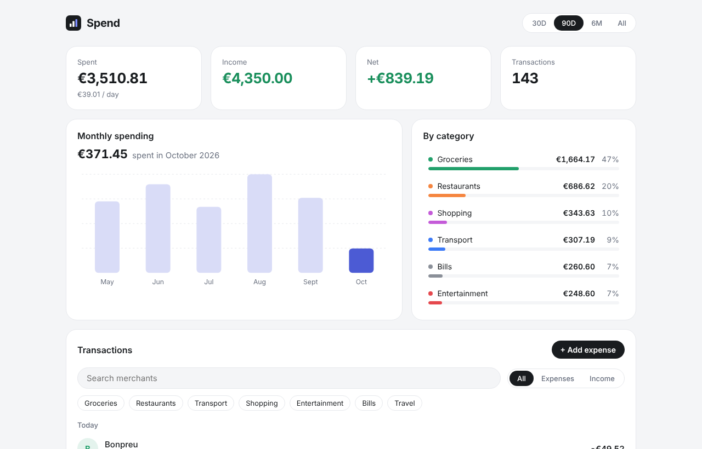

# Spend — personal finance dashboard

A clean, fast spending dashboard built with **React 19 + TypeScript + Vite**.
Filter six months of transactions, see where the money goes, and add your own expenses.



**Live demo:** _add your Vercel URL here_

## Features

- **Summary cards**: spent, income, net and daily average for the selected period (30D / 90D / 6M / All).
- **Monthly spending chart**: hand-built SVG bar chart (no chart library), with hover read-out.
- **Category breakdown**: share of spending per category. Click a row to filter by it.
- **Transactions**: grouped by day, with merchant search, type filter (expenses / income), category chips and pagination.
- **Add expense**: validated form (amount parsing accepts `12.50` or `12,50`, no future dates). Persists in `localStorage`.
- **Light and dark mode**, responsive down to 360 px, keyboard accessible (radio groups, `aria-pressed`, focus rings).

## Technical decisions

| Decision | Why |
|---|---|
| Money stored as **integer cents** | Avoids floating-point errors (`0.1 + 0.2 !== 0.3`). Formatting happens only at the edge with `Intl.NumberFormat`. |
| **Pure functions** for all business logic (`src/lib/finance.ts`) | Filtering, aggregation and formatting are framework-free and unit-tested. Components only render. |
| Dates parsed as **UTC** | Results never shift with the user's time zone. |
| **Seeded PRNG** for demo data | Same data on every load, so screenshots and tests are reproducible. |
| No chart library | The bar chart is ~80 lines of SVG. Smaller bundle, full control over styling and accessibility. |
| `useMemo` for derived state | Only `transactions` and `filters` are state. Everything else is derived, so it can't get out of sync. |

## Project structure

```
src/
├── App.tsx                  # State + layout
├── components/              # Presentational components
│   ├── MonthlyChart.tsx     # SVG bar chart
│   ├── CategoryBreakdown.tsx
│   ├── TransactionList.tsx
│   ├── AddTransactionForm.tsx
│   ├── Segmented.tsx
│   └── StatCard.tsx
├── lib/
│   ├── finance.ts           # Filtering, aggregation, formatting (pure)
│   ├── finance.test.ts      # Unit tests (Vitest)
│   ├── types.ts
│   └── categories.ts
└── data/sampleTransactions.ts  # Deterministic demo data
```

## Getting started

```bash
npm install
npm run dev      # http://localhost:5173
npm test         # unit tests
npm run build    # type-check + production build
```

## Deploy

Push to GitHub, import the repo in [Vercel](https://vercel.com/new) and accept the defaults (framework: Vite). No environment variables needed.

## Next steps

- Import transactions from a CSV bank export
- Monthly budgets per category with progress bars
- Component tests with React Testing Library
